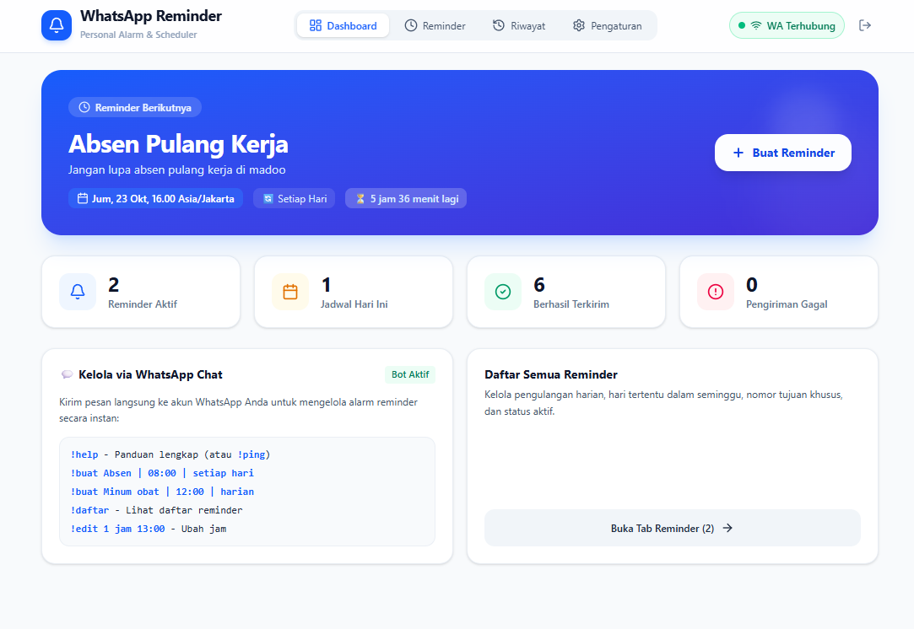

<div align="center">

# ⏰ WhatsApp Reminder

### Asisten Pengingat Pribadi Otomatis via WhatsApp — Praktis, Tepat Waktu, & Bebas Lupa

[](https://nodejs.org/en/blog/vulnerability/october-2026-security-releases)
[](https://go.dev/)
[](https://vuejs.org/)
[](https://github.com/tulir/whatsmeow)
[](https://modernc.org/sqlite)
[](https://www.docker.com/)
[](https://web.dev/progressive-web-apps/)

<br/>



<br/><br/>

[💡 Kenapa Butuh Ini?](#-kenapa-butuh-whatsapp-reminder) •
[✨ Fitur Utama](#-fitur-utama) •
[💬 Perintah Chat WhatsApp](#-kelola-via-chat-whatsapp-bot-commands) •
[🚀 Cara Menggunakan](#-panduan-penggunaan-untuk-pengguna-baru) •
[🛠️ Instalasi & Deployment](#-instalasi--deployment) •
[🛡️ Keamanan](#️-kepatuhan-keamanan-oktober-2026) •
[❓ Tanya Jawab (FAQ)](#-pertanyaan-umum-faq)

</div>

---

## 💡 Kenapa Butuh WhatsApp Reminder?

Pernahkah Anda mengalami situasi seperti ini?
- ❌ **Lupa absen masuk atau pulang kerja** karena sibuk di depan komputer.
- ❌ **Lupa jadwal minum obat, vitamin, atau kontrol kesehatan**.
- ❌ **Alarm HP biasa sering di-snooze lalu ditinggal tidur lagi**.
- ❌ **Melewatkan jadwal meeting penting atau tenggat waktu tugas harian**.

**WhatsApp Reminder** hadir sebagai solusi praktis! Aplikasi ini bekerja seperti **asisten pribadi** yang akan mengirimkan pesan pengingat langsung ke nomor WhatsApp Anda tepat pada waktu yang ditentukan. Pesan masuk sebagai chat WhatsApp biasa, sehingga jauh lebih diperhatikan, ada riwayat teksnya, dan tidak mudah terlewat!

---

## ✨ Fitur Utama

| Fitur | Deskripsi |
| :--- | :--- |
| 📱 **Web Dashboard Modern & PWA** | Tampilan bersih, responsif di HP maupun laptop. Bisa di-install langsung ke layar utama (*Add to Home Screen*) layaknya aplikasi smartphone. |
| 🤖 **Kelola Langsung via Chat WhatsApp** | Tidak sempat buka dashboard? Cukup ketik chat ke nomor sendiri (contoh: `!buat Minum obat \| 12:00 \| setiap hari`), alarm langsung aktif! |
| 🔄 **Jadwal Sangat Fleksibel** | Mendukung pengingat **Sekali Saja**, **Setiap Hari (Harian)**, **Hari Tertentu** (misal: Senin s/d Jumat), maupun **Mingguan**. |
| 🌐 **Multi Zona Waktu Indonesia** | Bebas pilih zona waktu sesuai lokasi Anda: **WIB** (`Asia/Jakarta`), **WITA** (`Asia/Makassar`), atau **WIT** (`Asia/Jayapura`). |
| ⚡ **WhatsApp Multi-Device Mandiri** | Menggunakan teknologi sesi WhatsApp multi-device. Begitu QR Code di-scan, sistem berjalan otomatis di server meski HP Anda sedang mati atau offline. |
| 🔒 **Aman dengan PIN & Rate Limiting** | Dashboard web dilindungi PIN keamanan 4–12 digit terenkripsi (*bcrypt*), pencegahan brute-force (auto-lockout), dan token akses JWT. |
| 🪶 **Sangat Ringan & Hemat Sumber Daya** | Dibangun dengan binary Go mandiri dan SQLite murni (tanpa CGO). Hanya menggunakan RAM sekitar **~30MB - 50MB**! |
| 💾 **Backup Database Otomatis** | Dilengkapi fitur backup aman satu klik (*SQLite VACUUM*) untuk mencadangkan jadwal dan riwayat pengiriman Anda. |

---

## 💬 Kelola via Chat WhatsApp (Bot Commands)

Anda dapat mengelola alarm dan jadwal langsung melalui obrolan WhatsApp (melalui fitur **"Message Yourself / Chat ke Diri Sendiri"** ataupun nomor khusus bot).

> ⚠️ **Catatan:** Seluruh perintah wajib diawali dengan tanda seru (`!`) agar sistem membedakan antara perintah dan percakapan biasa.

```text
 ┌────────────────────────────────────────────────────────────────────────┐
 │                      CONTOH PERINTAH CEPAT                             │
 ├────────────────────────────────────────────────────────────────────────┤
 │  !help                                                                 │
 │  !buat Absen Pulang Kerja | 16:00 | setiap hari                        │
 │  !buat Olahraga Pagi | 06:00 | senin, rabu, jumat                      │
 │  !buat Bayar Tagihan Listrik | 2026-11-01 09:00 | sekali               │
 │  !daftar                                                               │
 │  !edit 1 jam 16:30                                                     │
 │  !nonaktifkan 1                                                        │
 │  !aktifkan 1                                                           │
 │  !hapus 1                                                              │
 └────────────────────────────────────────────────────────────────────────┘
```

### Tabel Rincian Perintah Bot:

| Perintah | Contoh Format Chat | Keterangan |
| :--- | :--- | :--- |
| `!help` atau `!bantuan` | `!help` | Menampilkan seluruh daftar perintah dan bantuan cara pakai. |
| `!ping` | `!ping` | Memeriksa respon bot dan status koneksi WhatsApp. |
| `!buat` atau `!tambah` | `!buat Absen Masuk \| 08:00 \| setiap hari` | Membuat jadwal pengingat harian pada jam 08:00. |
| `!buat` (Hari tertentu) | `!buat Gym \| 17:00 \| senin, rabu, jumat` | Membuat jadwal yang hanya aktif pada hari-hari tertentu. |
| `!buat` (Sekali saja) | `!buat Kirim Laporan \| 2026-10-25 14:00 \| sekali` | Pengingat 1x kirim dengan format tanggal `YYYY-MM-DD HH:mm`. |
| `!daftar` atau `!list` | `!daftar` | Melihat daftar semua reminder beserta nomor ID dan status aktifnya. |
| `!detail <id>` | `!detail 1` | Menampilkan rincian lengkap dari reminder nomor ID 1. |
| `!edit <id> jam <jam>` | `!edit 1 jam 08:30` | Mengubah jam pengingat tanpa perlu membuat ulang reminder. |
| `!aktifkan <id>` | `!aktifkan 1` | Mengaktifkan kembali pengingat yang sebelumnya dimatikan. |
| `!nonaktifkan <id>` | `!nonaktifkan 1` | Menjeda/mematikan sementara pengingat tanpa menghapusnya. |
| `!hapus <id>` | `!hapus 1` | Menghapus pengingat secara permanen. |

---

## 🚀 Panduan Penggunaan untuk Pengguna Baru

Hanya butuh **4 langkah mudah** untuk mulai menggunakan asisten WhatsApp Anda:

```text
  [ 1. Buka Web ] ──► [ 2. Buat PIN ] ──► [ 3. Scan QR WA ] ──► [ 4. Siap Digunakan! ]
```

1. **Buka Dashboard Aplikasi:**
   Buka alamat web aplikasi Anda di browser HP atau PC (misal: `http://localhost:8080` atau alamat domain Anda).
2. **Atur PIN Pengaman:**
   Saat pertama kali dibuka, buat PIN angka (4–12 digit) untuk melindungi dashboard agar tidak dapat diakses orang lain.
3. **Hubungkan WhatsApp (Scan QR):**
   - Klik tombol **Hubungkan WhatsApp** di dashboard.
   - Buka WhatsApp di smartphone Anda ➔ Pilih **Menu (titik tiga) / Pengaturan** ➔ **Perangkat Tertaut (Linked Devices)** ➔ **Tautkan Perangkat**.
   - Arahkan kamera HP ke QR Code yang tampil di layar web.
   - Dalam beberapa detik status akan berubah menjadi **WA Terhubung (🟢)**.
4. **Mulai Buat Reminder:**
   Buat jadwal baru lewat tombol **+ Buat Reminder** di web atau kirim chat perintah `!buat` langsung di WhatsApp Anda!

---

## 🛠️ Instalasi & Deployment

Pilih metode instalasi yang paling sesuai dengan kebutuhan Anda:

### Opsi A: Menggunakan Docker Compose (Sangat Direkomendasikan ⭐)

Metode termudah, paling rapi, dan terisolasi dengan aman untuk VPS atau server rumahan.

1. **Pastikan Docker dan Docker Compose telah terpasang.**
2. **Clone repositori dan salin konfigurasi:**
   ```bash
   git clone https://github.com/oxydaid/rep-task-reminder.git
   cd rep-task-reminder
   cp .env.example .env
   ```
3. **Jalankan aplikasi:**
   ```bash
   docker compose up -d --build
   ```
4. **Cek status log:**
   ```bash
   docker compose logs -f whatsapp-reminder
   ```
5. Akses dashboard di browser melalui `http://IP_SERVER:8080`. Seluruh data tersimpan aman di folder `./data`.

---

### Opsi B: Menggunakan Native VPS (Binary Go + PM2)

Cocok untuk pengguna VPS dengan resource terbatas yang ingin performa maksimal tanpa overhead container.

1. **Pastikan Node.js (v24 LTS aman) dan Go (1.27+) terpasang:**
   ```bash
   # Gunakan NVM untuk mengaktifkan Node.js versi aman
   nvm install 24.22.1 && nvm use 24.22.1
   npm install -g pm2
   ```
2. **Kompilasi Fullstack (Frontend + Backend):**
   ```bash
   chmod +x build.sh
   ./build.sh
   ```
3. **Jalankan dengan PM2 Process Manager:**
   ```bash
   pm2 start ecosystem.config.cjs
   pm2 save
   ```
4. **Perintah PM2 yang sering digunakan:**
   ```bash
   pm2 status                  # Cek status proses
   pm2 logs whatsapp-reminder  # Pantau log secara langsung
   pm2 restart whatsapp-reminder # Me-restart aplikasi
   ```

---

### Opsi C: Menjalankan di Komputer Lokal (Development)

Untuk Anda yang ingin memodifikasi kode atau mencoba di laptop pribadi:

- **Di Linux / macOS / Git Bash:**
  ```bash
  npm run dev
  # ATAU
  ./dev.sh
  ```
- **Di Windows:**
  Cukup **klik ganda (double-click)** file `dev.bat` atau jalankan di CMD:
  ```cmd
  dev.bat
  ```

Keduanya akan otomatis mengaktifkan dua server secara berdampingan:
- 🌐 **Frontend (Vue 3 Vite):** `http://localhost:5173`
- ⚙️ **Backend API (Go Fiber):** `http://localhost:8080`

---

## 🔒 Konfigurasi Nginx & Domain HTTPS (Opsional)

Untuk menghubungkan domain pribadi Anda (misal `reminder.domainanda.com`) dan memasang sertifikat SSL gratis:

```nginx
server {
    server_name reminder.domainanda.com;

    location / {
        proxy_pass http://127.0.0.1:8080;
        proxy_http_version 1.1;
        proxy_set_header Upgrade $http_upgrade;
        proxy_set_header Connection 'upgrade';
        proxy_set_header Host $host;
        proxy_set_header X-Real-IP $remote_addr;
        proxy_set_header X-Forwarded-For $proxy_add_x_forwarded_for;
        proxy_set_header X-Forwarded-Proto $scheme;
    }
}
```

Aktifkan SSL dengan Certbot:
```bash
certbot --nginx -d reminder.domainanda.com
```

---

## 🛡️ Kepatuhan Keamanan (Oktober 2026)

Proyek ini telah dikonfigurasi dan diuji secara ketat agar **100% patuh terhadap standar keamanan rilis Node.js Oktober 2026** ([Node.js October 2026 Security Releases](https://nodejs.org/en/blog/vulnerability/october-2026-security-releases)):

- ✅ **Mitigasi CVE Kritis:**
  - `CVE-2026-105482` (High — DNS resolve NUL truncation).
  - `CVE-2026-105483` & `CVE-2026-106069` (High — TLS certificate hostname bypass).
  - `CVE-2026-111497` (High — Brotli decoder out-of-bounds write RCE).
  - `CVE-2026-105481` (Medium — Keep-alive socket desync).
  - Pembaharuan CA Certificates untuk mencegah kompromi *eMudhra Intermediate CA*.
- ✅ **Base Image Ter-patch:** Dockerfile menggunakan `node:24-alpine` (Node.js 24 LTS) yang telah berisi seluruh patch keamanan.
- ✅ **Container Hardening:** Menjalankan user non-root (`appuser`), proteksi `no-new-privileges:true`, proses init container (`init: true`), dan graceful shutdown 15 detik.
- ✅ **Built-in Validator:** Anda dapat menjalankan verifikasi keamanan kapan saja dengan:
  ```bash
  npm run check:node
  ```

---

## 📂 Struktur Direktori Proyek

```text
reminder/
├── backend/
│   ├── cmd/server/          # Entry point aplikasi Go Fiber
│   ├── internal/
│   │   ├── api/             # REST API routes, JWT middleware, & request handlers
│   │   ├── auth/            # Enkripsi PIN (bcrypt), token JWT, proteksi lockout
│   │   ├── database/        # Koneksi SQLite WAL, migrasi tabel, & backup VACUUM
│   │   ├── reminder/        # Logika CRUD reminder, kalkulasi jadwal, & log status
│   │   ├── scheduler/       # Mesin penjadwal otomatis & pencegah duplikasi kirim
│   │   └── whatsapp/        # whatsmeow client & parser perintah bot WhatsApp
│   └── go.mod
├── frontend/
│   ├── src/
│   │   ├── api/             # Client HTTP helper
│   │   ├── components/      # Komponen antarmuka (Dashboard, Reminder, Log, Modal)
│   │   ├── composables/     # State management & reactive composables
│   │   └── types/           # Definisi interface TypeScript
│   ├── public/              # Manifest PWA & icon aset
│   └── vite.config.ts
├── data/                    # Volume persisten database SQLite (reminders.db & whatsapp.db)
├── bin/                     # Lokasi output file binary kompilasi
├── build.sh                 # Script build 1-klik untuk Linux / VPS
├── build.bat                # Script build 1-klik untuk Windows
├── Dockerfile               # Konfigurasi container multi-stage berkeamanan tinggi
├── compose.yaml             # Orkestrasi Docker Compose siap produksi
├── ecosystem.config.cjs     # Konfigurasi PM2 Process Manager
├── image.png                # Tangkapan layar tampilan dashboard aplikasi
├── .nvmrc                   # Pin versi Node.js LTS ter-patch (v24.22.1)
└── README.md
```

---

## ❓ Pertanyaan Umum (FAQ)

<details>
<summary><b>1. Apakah HP saya harus selalu menyala dan terhubung ke internet?</b></summary>
<br/>
<b>Tidak!</b> Berkat teknologi WhatsApp Multi-Device resmi, setelah Anda menautkan perangkat melalui scan QR Code, server backend akan terhubung secara mandiri langsung ke server WhatsApp. Pengingat akan tetap terkirim tepat waktu meskipun smartphone Anda mati, kehabisan baterai, atau sedang tidak ada sinyal.
</details>

<details>
<summary><b>2. Apakah nomor WhatsApp saya aman dari risiko pemblokiran (banned)?</b></summary>
<br/>
<b>Sangat aman!</b> WhatsApp Reminder dirancang khusus untuk penggunaan pribadi (<i>Personal Reminder</i>), di mana pesan dikirimkan ke nomor Anda sendiri (Note to Self) atau ke orang terdekat dengan volume wajar layaknya percakapan normal. Sistem ini tidak melakukan blast massal spam ke nomor asing yang berisiko melanggar ketentuan WhatsApp.
</details>

<details>
<summary><b>3. Bagaimana cara memasang aplikasi ini di layar utama HP (PWA)?</b></summary>
<br/>
Buka alamat web dashboard di browser HP Anda (Chrome di Android atau Safari di iPhone). Pada menu browser, pilih <b>"Tambahkan ke Layar Utama" (Add to Home Screen)</b> atau <b>"Install App"</b>. Ikon WhatsApp Reminder akan muncul di menu smartphone Anda dan dapat dibuka fullscreen tanpa address bar layaknya aplikasi native.
</details>

<details>
<summary><b>4. Bagaimana jika saya lupa PIN masuk dashboard?</b></summary>
<br/>
Karena Anda adalah pemilik server/database, Anda dapat mereset PIN dengan mengakses file database SQLite di server:
<pre><code>sqlite3 data/reminders.db "DELETE FROM app_settings WHERE key IN ('pin_hash', 'failed_login_attempts', 'login_locked_until');"</code></pre>
Setelah perintah dijalankan, muat ulang (refresh) halaman dashboard di browser, dan Anda akan diminta membuat PIN baru.
</details>

<details>
<summary><b>5. Bagaimana cara memulihkan (restore) data dari file backup?</b></summary>
<br/>
1. Hentikan aplikasi: <code>docker compose down</code> atau <code>pm2 stop whatsapp-reminder</code>.<br/>
2. Salin file backup cadangan ke lokasi aktif:
<pre><code>cp data/backups/backup_xxxx.db data/reminders.db</code></pre>
3. Nyalakan kembali aplikasi: <code>docker compose up -d</code> atau <code>pm2 start ecosystem.config.cjs</code>.
</details>

---

## 📄 Lisensi

Dilisensikan di bawah **MIT License**. Terbuka dan bebas digunakan untuk kebutuhan pribadi, self-hosted, maupun pengembangan lebih lanjut.
